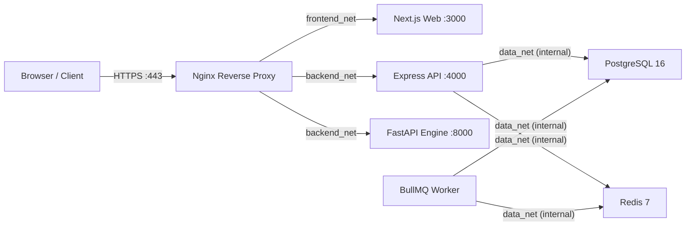
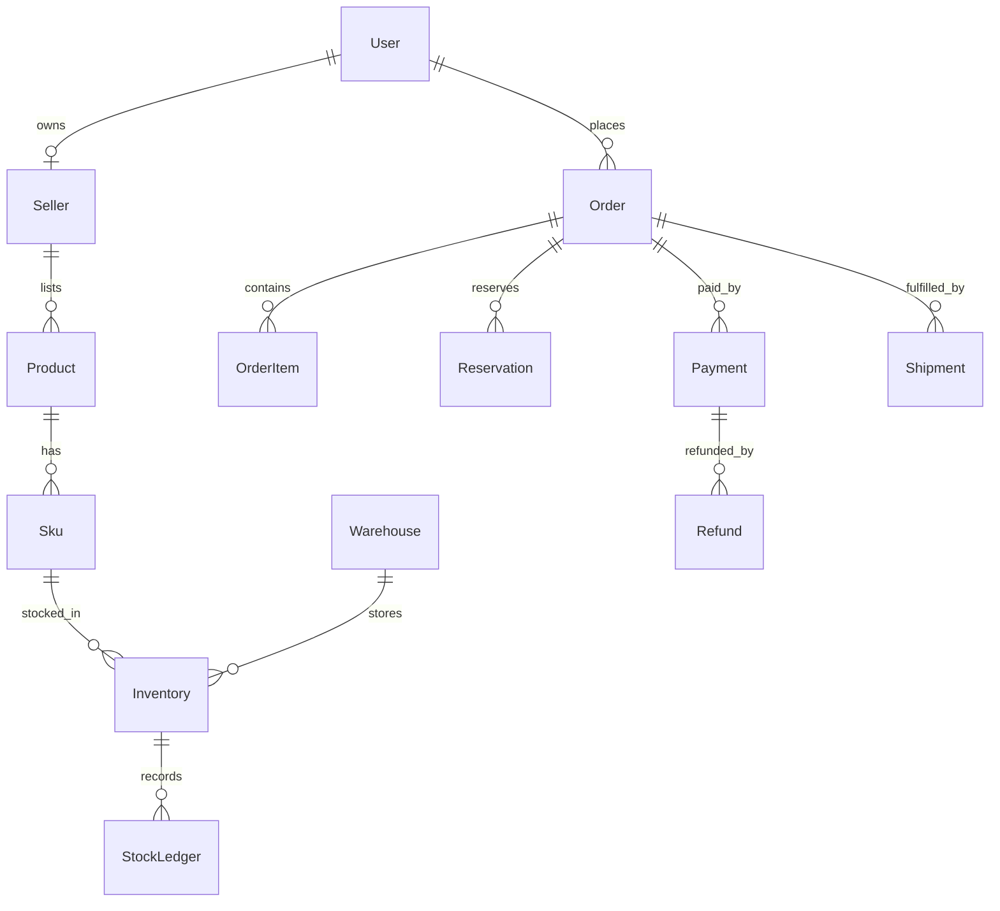
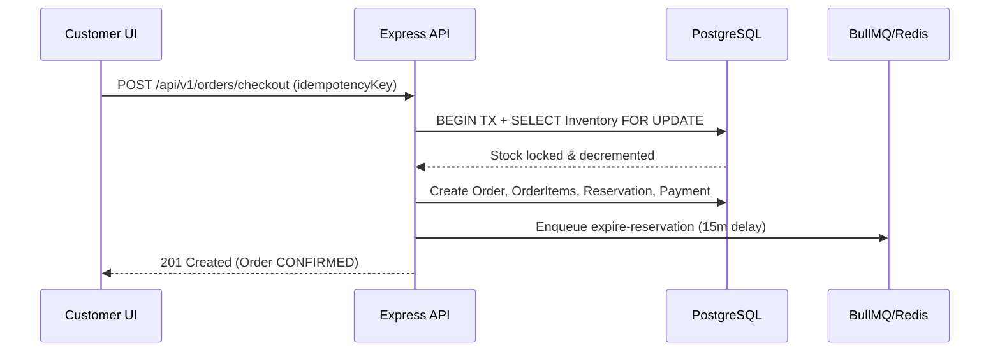

# MarketSphere Architecture & Diagrams

## System Architecture

## Entity-Relationship Overview

## Checkout Data Flow

## Known Limitations
- Payment, shipping, email, and object storage adapters run in **Local Simulation** mode (₹0 strict budget; no paid external sandboxes).
- Live cloud VM deployment and GitHub remote branch protection require external hosting/GitHub repository configuration.
